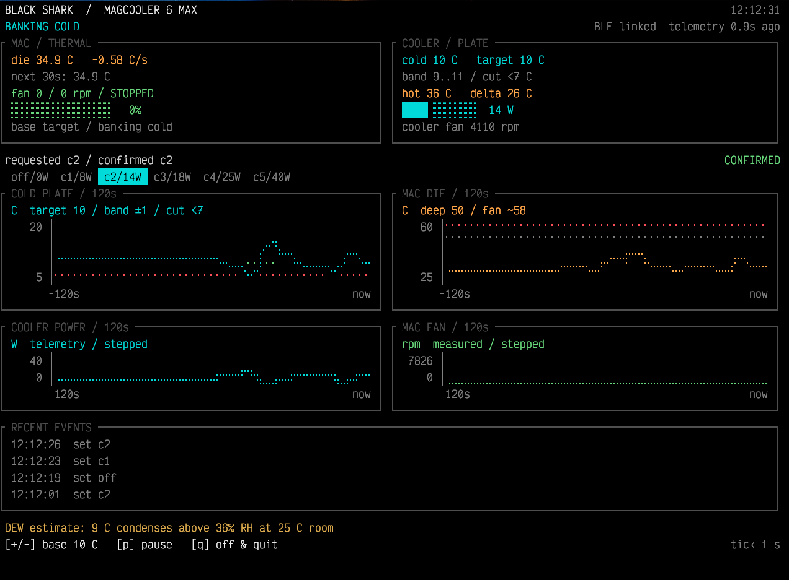

[English](README.md) | [中文](README.zh-CN.md)

# Black Shark Mac Fan Guard

macOS controller for a Black Shark MagCooler 6 Max over BLE. It reads Apple Silicon die temperature and Mac fan speed, sets the cooler level and the cold-plate target, and turns the cooler off when this process exits, stalls, or the Mac goes to sleep.



The capture above is the wide layout: cold plate, die, cooler power, and Mac fan over the last 120 seconds.

## Build and offline checks

```sh
mkdir -p build
swiftc -O -warnings-as-errors shark_cooler.swift -o build/shark_cooler
build/shark_cooler --selftest
python3 tests/tui_render.py
python3 tests/control_ramp.py
python3 tests/ble_recovery.py
```

The render test compiles the display code and pure functions against a fixed state. It leaves the BLE manager and hardware sensors alone. `build/tui_preview.ansi` is that fixed state.

## Run

This connects to the cooler and drives it:

```sh
build/shark_cooler --cold 10 --tick 1
```

`--cold` is the starting base plate target in °C. Default is 10. `--tick` is the sample interval in seconds. Default is 1, minimum 0.1. `--off` starts paused, with the cooler commanded off.

The TUI runs when stdin and stdout are both terminals. Otherwise each tick prints one log line.

A second copy exits. The lock file is `shark_cooler.lock` in the user temporary directory. The watchdog inherits that lock, so it stays held until the controller and the watchdog are both gone. If the watchdog cannot start, the controller exits before sending a level. If the PMU die sensors cannot be read, it exits the same way.

`q`, or SIGINT, SIGTERM, SIGHUP, or SIGQUIT, sends off and waits up to 8 seconds for telemetry to confirm it. If that confirmation is missing and the watchdog is still alive, the watchdog keeps trying for 30 seconds. Ten seconds without a heartbeat counts as a stall, and the watchdog turns the cooler off.

## Screen

The minimum window is 74 columns by 17 rows. The frame uses at most 33 rows. Usable width is one column less than the terminal, and at most 132. From 24 rows up, the cold-plate chart is shown. At 108 columns of usable width and 30 rows, four charts sit side by side.

Cold-plate and die scales follow the samples and mark the current thresholds. Fan and power scales are fixed. Missing samples stay gaps. Borders are square. Gauges use Unicode blocks. Curves use Braille.

The screen keeps the requested level, the telemetry-confirmed level, and a pending confirmation apart. It also shows Mac fan speed, the 30-second die projection, plate and hot-side temperatures, their difference, power, and recent events. A die-sensor fault and stale telemetry each have their own text.

`+` or `=` raises the base target, up to 25 °C. `-` or `_` lowers it, down to 5 °C. `p` pauses or resumes. Pause commands the cooler off.

## Plate control

Levels move one step at a time: off, c1, c2, c3, c4, c5, at 0 / 8 / 14 / 18 / 25 / 40 W. A level counts as confirmed only when telemetry received at least 1 second later shows that level's power. Off is confirmed only at 0 W.

More than 4 °C above target, the level rises at most once every 3 seconds. Closer than that, and still above the band, a rise waits 5 seconds. Below the band, the level falls at most once a second. Inside the band, target ± 1 °C, the level holds. No plate reading, or a plate colder than the hard floor, turns the cooler off at once. The hard floor is 3 °C under the target. The screen prints it as `cut <`.

Deep cooling lowers the plate target by 4 °C. It is on when the 30-second die projection reaches 50 °C, while the Mac fan is running, or for 90 seconds after that fan stops. The projection uses a rising slope only. With the fan idle and that 90-second window over, deep cooling ends once the projection is more than 3 °C below 50 °C. Otherwise the plate stays at the base target. The die chart also marks the measured Mac fan-start region near 58 °C. That mark is a reference, separate from the 50 °C deep-cooling line.

The dew line assumes a 25 °C room and uses the lower edge of the target band. The cooler has no humidity sensor. Check the real room and humidity before choosing a low target.

## BLE

Connecting, service discovery, characteristic discovery, notification subscription, and the first valid telemetry each time out after 10 seconds. Failure clears the session. Two seconds later a new Bluetooth manager scans again. The scan waits until a cooler whose advertised name contains `6max` is up, or attaches one already connected to this Mac. Bluetooth off clears the connection state. Bluetooth on resumes the scan. These timers stay on their own clock, independent of `--tick`.

During sleep, a link that can still be written is kept so the off command can be confirmed. A setup timeout in that state waits until wake. Sleep is held for up to 8 seconds while the program asks telemetry to confirm off, then allowed either way.

Subscription sends one telemetry request immediately. Later polls follow `--tick`. A lost first request hits the 10-second setup timeout and reconnects, including when `--tick` is longer than that. On an established link, telemetry older than 10 seconds shuts cooling off through the existing path. That case leaves the session in place.

`tests/ble_recovery.py` runs the production connection callbacks on an offline transport double. It covers timeouts, discovery failure, stale callbacks, and Bluetooth state changes.

Mode frames and the status layout come from the MagCooler 6 notes in romestylez/BlackSharkLib. The custom levels 1–5 were checked on this hardware at a steady 8 / 14 / 18 / 25 / 40 W.
